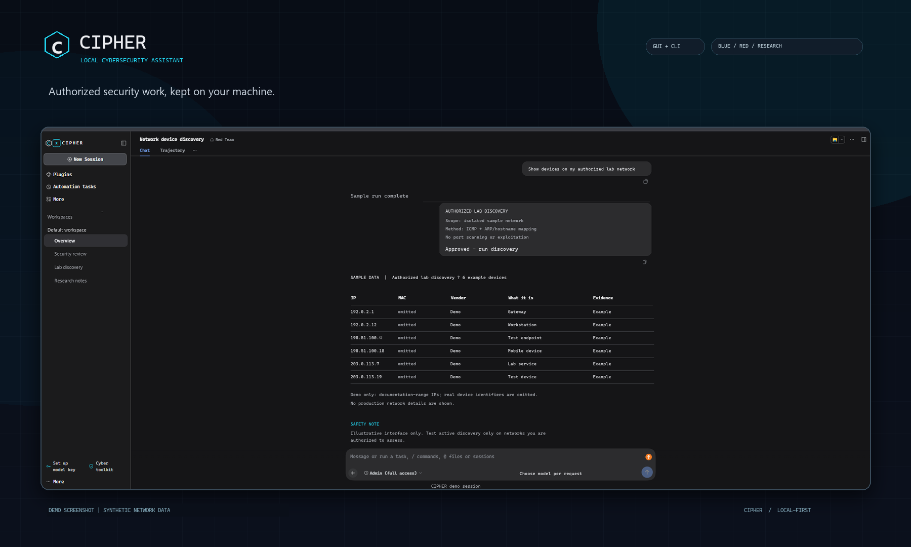

# CIPHER

CIPHER is a local cybersecurity assistant for authorized security work. Its
shared rules are in `AGENTS.md`; each mode adds one editable instruction file:
`CIPHER-BLUE-TEAM.md`, `CIPHER-RED-TEAM.md`, or
`CIPHER-RESEARCH-MODE.md`.

## CIPHER in action



*Illustrative screenshot; network values are synthetic and use documentation-only IP ranges.*

## Requirements

- Node.js 24.9 or newer
- An API key for a supported model provider

## Install and start

Clone the repository and enter the project folder:

```sh
git clone https://github.com/VicVibes/cipher-agent.git
cd cipher-agent
```

Install Node.js 24.9 or newer first:

- **Windows:** open the official [Node.js downloads page](https://nodejs.org/en/download),
  choose the LTS release (24.9 or newer) and Windows Installer (`.msi`), then
  run the downloaded installer. Reopen PowerShell after setup.
- **Linux/macOS:** install [nvm](https://github.com/nvm-sh/nvm#installing-and-updating),
  then run:

  ```sh
  nvm install 24
  nvm use 24
  node --version
  npm --version
  ```

  `node --version` should report `v24.9.0` or newer. Then, from the project
  folder, run:

  ```sh
  chmod +x install.sh
  ./install.sh
  ```

On Windows, verify `node --version` and `npm --version` in a new PowerShell
window, then double-click `install.bat`.

The installer installs the CIPHER runtime dependencies on first run, then
starts the GUI. Add your model key under **Settings → Models**.

You can also provide `VENICE_API_KEY` in the environment. Credentials and
session data stay local and are ignored by Git. The default is DeepSeek V4.1
Flash 1017 Abliterated (E2EE), capped at 128K context and 8K output tokens.
Venice charges for tokens processed and generated, not for models merely
being listed. Enable several models in the provider setup, then choose which
one to use with the model picker; the first selected model is the default for
new sessions. Only the chosen model handles a request. Optional Auto Review
can add a separate model request for each tool action. Existing sessions may
retain their prior model selection; start a new session to use the current
default. Check provider spend controls before running long tasks.

## Start the GUI manually

```powershell
npm start
```

## CLI

The CLI runs without starting a browser or server. For a guided start:

- **Windows:** double-click `CIPHER-CLI.bat`.
- **Linux/macOS:** run `chmod +x CIPHER-CLI.sh` once, then `./CIPHER-CLI.sh`.

CIPHER prompts for a mode and task. Press Enter to use Blue Team. It defaults
to read-only permissions and has no live approval prompt.

You can also pass a task directly:

```sh
./CIPHER-CLI.sh --mode blue-team "Review this project's security configuration"
```

For scripts and automation, use `npm run start:cli -- --json "task"`. Continue
a headless conversation by copying `session.sessionId` from the opening event
and passing it on the next invocation:

```powershell
npm run start:cli -- --json "Review this project's security configuration"
npm run start:cli -- --session-id session-id-here "Continue the review"
```

Use the GUI for actions that require interactive approval. Red Team mode still
follows `AGENTS.md` and requires explicit authorization and scope.

## Modes

| Mode | Purpose |
|---|---|
| Blue Team | Defensive analysis, hardening, detection, and incident response |
| Red Team | Authorized, scoped testing under the shared safety rules |
| Research Mode | Learning, advisories, and local-source research |

## Security tool access

CIPHER can install needed tools from the limited allowlist in `AGENTS.md`.
Before installation, it must show the exact tool set, pinned versions, official
sources, install and rollback commands, then get your approval for that session.
This does not bypass the GUI's command approvals. Elevation, drivers, services,
paid tools, and tools outside the allowlist need separate approval. The CLI is
read-only by default and has no live approval prompt, so do not use it to
install tools. Installing a tool does not authorize testing a target; active
use still requires separate scope approval. Nmap is limited to authorized
inventory and Nuclei to scoped, non-destructive checks. Bettercap is restricted
to isolated, authorized labs and is not a drop-in replacement for Ettercap.
Password-guessing and credential-capture tools are not supported.

## Authorized use and privacy

Only assess systems you own or have explicit permission to test. Keep active
testing scoped and non-destructive; the mode presets do not replace
authorization or provide a security sandbox. Never publish `.dsh` credentials,
session data, or tokenized URLs. Phone mode shares the full session with anyone
who has its link, so use it only on a trusted network and keep the link private.

## Project layout

| Path | Purpose |
|---|---|
| `AGENTS.md` | Shared project rules for every mode |
| `CIPHER-*.md` | Mode-specific instructions |
| `.dsh/profiles/web/` | GUI profile and model configuration |
| `.dsh/profiles/headless/` | CLI profile using the same model and shared rules |
| `cipher-brand/` | CIPHER interface branding |
| `scripts/` | Cross-platform launchers |
| `node-app/` | Runtime dependency installation |

# Enable Passwordless Sudo in Kali Linux

Run the following command in your terminal:
```bash
sudo visudo
```
Add this line at the bottom (replace `kali` with your username):
```bash
kali ALL=(ALL:ALL) NOPASSWD: ALL
```
Save and exit:
- `CTRL + O` → Enter
- `CTRL + X`
### Test
```bash
sudo -k
sudo whoami
```
Expected output:
```text
root
```
**Alternative (one command):**
```bash
echo "$(whoami) ALL=(ALL:ALL) NOPASSWD: ALL" | sudo tee /etc/sudoers.d/$(whoami)
sudo chmod 440 /etc/sudoers.d/$(whoami)
```
**Note:** Passwordless sudo gives your account unrestricted root access. Use it only on a trusted machine or lab VM.
For Kali/Linux instructions, see [`scripts/KALI.md`](scripts/KALI.md). Do not
publish `.git`, `node_modules`, credentials, browser profiles, local overrides,
or runtime/session data. The `.gitignore` excludes these and local-only
reconnaissance/exploitation skill files.
